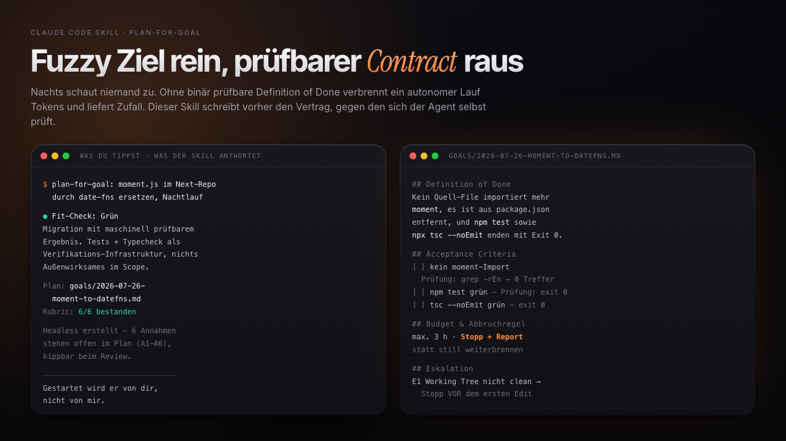

# plan-for-goal



*Ich lasse Agenten nachts arbeiten. Am Anfang habe ich ihnen Ziele wie „räum das mal auf" gegeben und mich morgens über das Ergebnis geärgert. Der Fehler lag nicht am Modell, sondern an mir. Ein Lauf ohne prüfbare Zielbedingung kann gar nicht gut ausgehen, weil der Agent nicht weiß, wann er fertig ist, und stattdessen so lange weitermacht, bis irgendwas passiert. Dieser Skill zwingt mich, das vorher hinzuschreiben. · Simon Schaefer, Juli 2026*

Die Idee: Ein Goal-Plan ist der Contract zwischen Mensch und autonom laufendem Agenten. Der Agent arbeitet in einer Schleife (Turn, Selbst-Check gegen die Zielbedingung, weiter oder Stopp) und niemand schaut zu, also entscheidet die Qualität des Plans über den ganzen Lauf. Dieser Skill macht aus einem fuzzy Ziel ein Markdown-Dokument mit binär entscheidbarer Definition of Done, Acceptance Criteria samt Prüfmethode, ausführbaren Verification-Kommandos, Budget, Abbruch- und Eskalationsregeln. Davor steht ein Ampel-Fit-Check, der ehrlich sagt, ob das Ziel überhaupt loop-tauglich ist: Grün gibt den vollen Plan, Gelb zerlegt in autonomen Teil und Mensch-Teil, Rot rät ab. Kernprinzip: Ohne prüfbare Definition of Done gibt es keinen Lauf.

## How it works

- **`SKILL.md`** — der Flow in sechs Schritten plus die Qualitäts-Rubric, gegen die jeder Plan geprüft wird, bevor er gespeichert werden darf. Hier liest Claude, was zu tun ist.
- **`references/fit-check.md`** — die Ampel mit Mustern und Grenzentscheidungen. Lädt nur in Schritt 1.
- **`references/goal-plan-template.md`** — Template, Feld-Anleitung und ein vollständig ausgefülltes Beispiel. Lädt nur in Schritt 4.

Die zentrale Konstante ist die Rubric: sechs Checks, alle müssen bestehen. Fällt einer durch, wird der Plan nachgebessert statt durchgewunken. Der häufigste Durchfaller ist eine Definition of Done, die in Wahrheit ein Wunsch ist („Code ist sauber").

## Quick start

**Requirements:** [Claude Code](https://claude.com/claude-code). Sonst nichts, der Skill ist reines Markdown.

```bash
# 1. Global installieren (in allen Projekten verfügbar)
git clone https://github.com/simon-schaeferai/plan-for-goal.git ~/.claude/skills/plan-for-goal

# 2. Oder projekt-lokal, wenn nur ein Repo ihn haben soll
git clone https://github.com/simon-schaeferai/plan-for-goal.git .claude/skills/plan-for-goal

# 3. Prüfen
ls ~/.claude/skills/plan-for-goal/SKILL.md
```

Wenn Schritt 3 den Pfad ausgibt, bist du startklar. Claude triggert den Skill selbst, sobald du einen autonomen Lauf vorbereitest.

## Using it

Der erste Prompt, wörtlich:

```
plan-for-goal: moment.js im Next-Repo durch date-fns ersetzen,
ca. 47 Stellen, soll nachts alleine durchlaufen
```

Du musst kein fertiges Ziel mitbringen. „Ich verliere jede Woche zwei Stunden mit X" reicht als Einstieg, dann leitet der Skill Kandidaten-Goals daraus ab und lässt dich wählen. Am Ende liegt der Plan unter `goals/YYYY-MM-DD-<slug>.md` in deinem Projekt und du bekommst Pfad, Definition of Done und Startkommando zurück.

## Design choices

- **Der Fit-Check kommt vor dem Plan, nicht danach.** Ein Loop kann Arbeit wiederholen, aber nicht schmecken. Judgment, Taste und Richtungsentscheidungen bleiben deshalb beim Menschen. Nachteil: Du bekommst manchmal statt eines Plans ein begründetes Nein.
- **Rot heißt kein Plan, nicht ein schlechterer Plan.** Für „mach das Design schöner" wäre jede Definition of Done zwangsläufig fake („bis es gut ist"), und ein Schein-Plan verbrennt Stunden, bevor er auffällt.
- **Jedes Acceptance Criterion trägt seine Prüfmethode.** Kommando, Datei-Existenz oder Zählwert, nie „sieht gut aus". Nachteil: In Projekten ohne Testinfrastruktur wird das unbequem ehrlich. Der Plan schreibt die Lücke dann als Risiko hin, statt ein `npm test` zu erfinden, das es nicht gibt.
- **Der Skill startet den Lauf nie selbst.** Planung und Ausführung sind getrennt, das Zünden bleibt ein bewusster menschlicher Akt. Nachteil: ein Schritt mehr, auch wenn du es eilig hast.
- **Zwei Felder brauchen deine ausdrückliche Bestätigung:** Definition of Done und Budget. Beide können den Lauf beenden, deshalb rät der Skill sie nicht. Nachteil: komplett headless geht damit nicht, ohne dass Annahmen im Plan stehen.

## Limitations

- Der Skill plant Läufe. Er führt sie nicht aus und überwacht sie nicht. Der Harness (Agent-Loop, Cron, Workflow-Runner) ist deine Sache, der Plan benennt ihn nur.
- Budget-Schätzungen sind grob. Der erste echte Lauf kalibriert sie, nicht der Plan.
- Alles auf Deutsch, inklusive der Sektionsnamen im Template. Für ein englischsprachiges Team übersetzt du `SKILL.md` und das Template, die Struktur bleibt identisch.
- Ein perfekter Plan macht ein schlechtes Ziel nicht gut. Rot bleibt Rot.

## License

MIT
